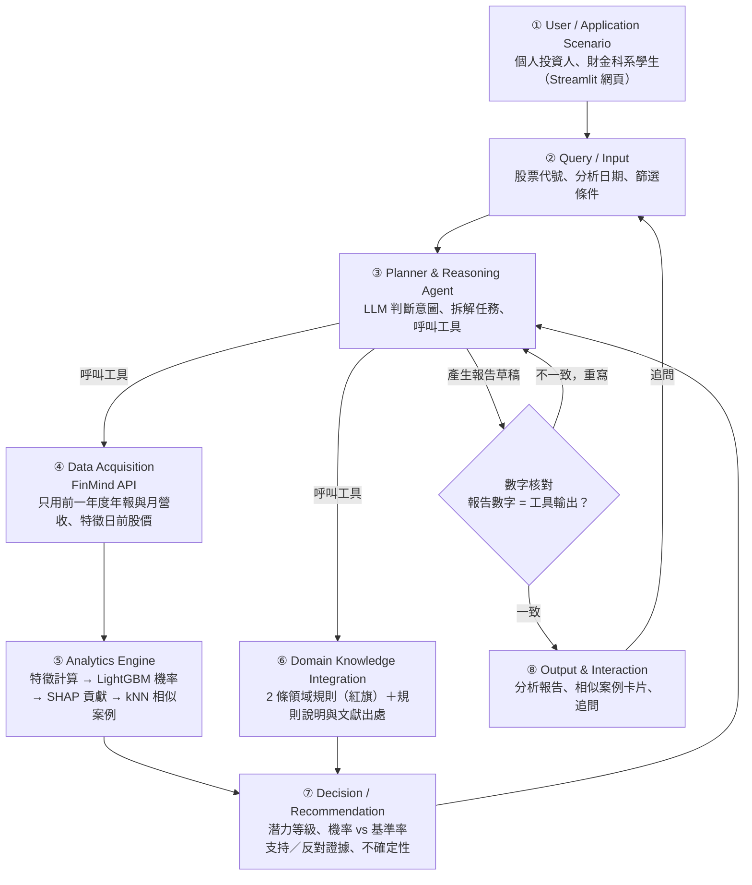

# Multibagger Scout 系統設計文件

> 本文件的目的：即使原開發者不在，下一位開發者仍能**理解、執行、驗證並繼續開發**本系統。
>
> **目前狀態：提案階段。** 只有「資料可行性驗證」已實作完成。標示「規劃中」的章節說明的是預計做法，**尚未實作，也沒有實驗結果**。
>
> 本系統為研究與教學用途，不構成投資建議。

---

## 1. Problem

台股中有少數公司在 5 年內帶來數倍報酬（multibagger，多倍股）。Bessembinder 等人 [2] 發現，長期股東報酬高度集中在極少數股票上。如果能提早辨識這類公司的特徵，對投資人與財金教學都有價值。不過目前的做法有三個問題：

1. **Look-ahead bias（前視偏誤）**：許多選股回測使用了「當時還沒公告」的財報，或只看現在還存活的公司（倖存者偏差），讓結果看起來比實際好。
2. **黑箱**：機器學習模型 [3] 可能預測得準，但使用者看不懂理由。
3. **LLM 幻覺**：直接問 LLM「這檔股票會不會漲」，它可能編造數字，或用到訓練資料裡的「未來」知識 [5]。

**研究問題**：在只使用當時公開資訊的前提下，能否提早辨識出未來 5 年含息報酬排名全體上市股票前 5%、**且由營收或獲利成長驅動**的台股（排除缺乏基本面支撐的炒作型上漲），並讓使用者看懂理由？

本專題參考 Yartseva [1] 對美股多倍股因子的研究，檢驗這些因子在台股是否成立，並結合 LLM 財報分析 [4] 的做法，建立一個時間一致（point-in-time）、可解釋的 Domain AI Agent。

---

## 2. Requirements

### 2.1 功能需求

| 編號 | 需求 | 狀態 |
|---|---|---|
| F1 | 使用者輸入股票代號與分析日期，系統輸出潛力等級、模型機率與基準率對照（訓練資料中主要標記的正例比例；會低於 5%，實際值待全量資料計算） | 規劃中（核心） |
| F2 | 報告列出支持與反對證據（SHAP 特徵貢獻＋領域規則紅旗），並說明不確定性 | 規劃中（核心） |
| F3 | 顯示歷史上特徵相似的成功與失敗案例（kNN） | 規劃中（核心） |
| F4 | 使用者可針對報告追問 | 規劃中（核心） |
| F5 | 全市場篩選：依條件列出某年度機率最高的公司 | 規劃中（延伸） |
| F6 | 網站上顯示回測成果 | 規劃中（延伸） |

### 2.2 非功能需求

| 需求 | 說明 |
|---|---|
| **時間一致性** | 分析日 t 只能使用 t 之前已公開的資料：財報與月營收只用前一年度（4 月底時一定已公告），股價只用 t 之前的交易資料；樣本包含後來下市的公司，避免倖存者偏差 |
| **可重現** | 固定亂數種子（目前為 `SEED = 42`）；API 回應快取在本機；套件版本寫在 `requirements.txt`；walk-forward 切分固定 |
| **可解釋** | 每個預測都附 SHAP 特徵貢獻與相似案例；報告中的數字一律來自程式輸出，並自動核對 |
| **資料授權** | FinMind 免費方案限非商業用途；原始資料（`cache/`）不上傳到 repo |
| **成本與限制** | 免費 API 每小時約 300 次（註冊後約 600 次），收集程式需能自動等待並接續 |

### 2.3 範圍與優先順序：核心目標與延伸目標

依實作風險排定優先順序：核心目標構成完整、可驗證的 Agent，必定完成；延伸目標視時程加入，未完成者列入 Future Work，並以替代方案確保系統仍可運作。

| 類別 | 項目 | 未完成時的替代方案 |
|---|---|---|
| 核心 | 全市場資料收集（含已下市公司） | — |
| 核心 | 資料集：只用前一年度年報與月營收的 10 項特徵＋產業類別；主要標記（報酬前 5%＋營收實質成長）、對照標記、流動性過濾、60 日平均結束價 | — |
| 核心 | LightGBM 與邏輯迴歸、三輪 walk-forward；實驗 E1、E2、E3 | — |
| 核心 | Agent：SHAP、kNN 相似案例、2 條領域規則（附固定說明與文獻出處）、LLM 報告與數字核對；E4 的數字正確率 | — |
| 核心 | Streamlit 個股分析頁（F1–F4） | — |
| 延伸 | 基本面確認加入 EPS 條件 | 只用營收成長 |
| 延伸 | E4 人工評分 | 只比較自動計算的數字正確率 |
| 延伸 | E5 敏感度分析 | 列入 Future Work |
| 延伸 | 網站全市場篩選頁、回測成果頁（F5、F6），部署至 Streamlit Community Cloud | 回測結果以圖表呈現於 README 與簡報；本機執行並錄製 Demo |

本文件其他章節中屬於延伸目標的項目，都會標註「（延伸）」；沒有標註的就是核心目標。

**不納入本專題（列為 Future Work）**：為控制範圍，以下項目不在本學期實作，只在結論的 Future Work 說明：

- 重大訊息摘要（需另外爬取公開資訊觀測站）
- RAG 知識庫（以 `knowledge/` 中每條規則的固定說明取代）
- 補齊已下市公司財報（只記錄缺漏比例）
- 其他領域規則：資產成長快於 EBITDA 成長、景氣循環股
- 使用季報與當年度月營收（本專題只用前一年度年報與月營收）

---

## 3. Architecture

系統由 8 個模組組成。**核心設計原則：數字一律由程式與模型計算，LLM 只負責規劃與解釋；報告中的數字會自動與工具輸出核對，不一致就重寫。**



| # | 模組 | 說明 | 狀態 |
|---|---|---|---|
| 1 | User / Application Scenario | 目標使用者是個人投資人與財金科系學生，透過 Streamlit 網頁操作 | 規劃中 |
| 2 | Query / Input | 接收股票代號、分析日期（預設為最新可用的 4 月底）、篩選條件（產業、市值等） | 規劃中 |
| 3 | Planner & Reasoning Agent | LLM 判斷使用者意圖（個股分析、篩選、追問），拆成工具呼叫序列，最後整合成報告 | 規劃中 |
| 4 | Data Acquisition | 從 FinMind 取得財報、月營收、股價、除權息等資料；財報與月營收只用前一年度（4 月底時一定已公告），股價只用特徵日前的交易資料 | 驗證完成，全市場收集規劃中 |
| 5 | Analytics Engine | 計算 10 項特徵＋產業類別 → LightGBM 輸出機率 → SHAP 算出各特徵貢獻 → kNN 在歷史樣本中找相似的成功與失敗案例（只用結果在分析日前已揭曉的歷史案例） | 規劃中 |
| 6 | Domain Knowledge Integration | 以 2 條規則檢查盈餘品質與估值紅旗，每條附固定說明與文獻出處（`knowledge/`） | 規劃中 |
| 7 | Decision / Recommendation | 綜合模型機率（與基準率對照）、規則結果，給出潛力等級、支持與反對證據、不確定性說明 | 規劃中 |
| 8 | Output & Interaction | 產出分析報告與相似案例卡片，支援使用者追問 | 規劃中 |

---

## 4. Components

| 程式檔 | 負責 | 輸入 | 輸出 | 狀態 |
|---|---|---|---|---|
| `verify_data.py` | 抽樣 30 檔驗證資料可得性、樣本量、含息報酬計算，匯出台積電核對表 | FinMind API（可選 `.env` Token） | `output/` 8 個檔案、`cache/` 快取 | **已完成** |
| `collect_data.py` | 收集全市場上市（含已下市）公司的 7 種資料，另抓 0050 股價與除權息供 E2 比較；自動等待 API 次數、可中斷後接續 | 股票清單、資料集清單 | `data/raw/*.parquet` | 規劃中 |
| `build_dataset.py` | 依時間一致性規則建立「公司 × 年份」特徵與兩種標記（主要、對照）資料表；套用流動性過濾 | `data/raw/` | `data/dataset.parquet` | 規劃中 |
| `train.py` | 依 walk-forward 切分訓練 LightGBM 與邏輯迴歸 | `data/dataset.parquet` | `models/` 模型檔 | 規劃中 |
| `evaluate.py` | 三輪回測、Baseline 比較、SHAP 分析（E1–E3）；（延伸）敏感度分析 E5 | 模型、資料集 | `results/` 表格與圖 | 規劃中 |
| `rules.py` | 領域規則檢查函式，每條規則回傳是否觸發與證據數字 | 單一公司當期特徵 | 規則結果清單 | 規劃中 |
| `agent.py` | Planner、案例檢索、規則說明、LLM 報告生成、報告數字核對 | 使用者查詢 | 結構化報告 | 規劃中 |
| `app.py` | Streamlit 網站：個股分析頁；（延伸）全市場篩選、回測成果頁 | 使用者操作 | 網頁 | 規劃中 |

`data/` 與 `models/` 為規劃中的輸出資料夾，產生後同樣不上傳。

---

## 5. Data

### 5.1 資料來源

| 資料 | FinMind 資料集代碼 | 用途 | 上市中抓取率 | 已下市抓取率 |
|---|---|---|---|---|
| 損益表 | `TaiwanStockFinancialStatements` | 毛利率、淨利、ROE 分子 | 19/20 | 4/10 |
| 資產負債表 | `TaiwanStockBalanceSheet` | ROE 分母、負債比、股本（計算市值） | 19/20 | 5/10 |
| 現金流量表 | `TaiwanStockCashFlowsStatement` | 營業現金流、資本支出（FCF） | 19/20 | 3/10 |
| 月營收 | `TaiwanStockMonthRevenue` | 年營收成長率（特徵）、5 年營收成長（標記） | 20/20 | 9/10 |
| 每日股價 | `TaiwanStockPrice` | 含息報酬、12 個月報酬、成交值（流動性過濾）、市值 | 20/20 | 10/10 |
| 本益比／淨值比／殖利率 | `TaiwanStockPER` | 本益比、帳面／市值 | 20/20 | 10/10 |
| 除權息結果 | `TaiwanStockDividendResult` | 計算含息報酬 | 20/20 | 8/10 |
| 股票基本資料 | `TaiwanStockInfo` | 股票清單、產業類別 | — | — |
| 下市櫃名單 | `TaiwanStockDelisting` | 納入已下市公司 | — | — |
| 0050 股價與除權息 | `TaiwanStockPrice`、`TaiwanStockDividendResult`（`data_id=0050`） | 實驗 E2 的買進持有基準 | — | — |

上市中唯一的缺漏，是近年才上市的公司。已下市公司的財報缺漏是已知限制（見第 12 節）。本專題只使用 FinMind 一個資料來源。

### 5.2 樣本

- 臺灣證券交易所上市普通股（4 位數、非 0 開頭代號），**包含後來下市的公司**
- 排除特徵日前一年**日均成交值最低 10%** 的冷門股：成交量很小的股票容易被少數人拉抬，報酬不代表基本面
- 目前上市普通股 1,229 家；2012 年後下市櫃 93 家

### 5.3 特徵（10 項＋產業類別）

| 類別 | 特徵 |
|---|---|
| 規模 | 市值 |
| 估值 | FCF 殖利率、帳面／市值、本益比 |
| 獲利能力 | ROE、毛利率 |
| 成長 | 年營收成長率（前一年度 vs 前兩年度） |
| 品質與財務結構 | 營業現金流／淨利、負債比 |
| 價格動能 | 過去 12 個月報酬 |
| 分類欄位 | 產業類別 |

**只用前一年度的資料**：財報特徵一律取前一年度年報（12/31），營收取前一年度 1–12 月合計，不使用當年度的季報或月營收。每個特徵都能由 FinMind 欄位直接取得或一次除法算出。Yartseva [1] 的主要因子（規模、價值、獲利、FCF）都保留。

刪除的特徵與原因：ROA（與 ROE 高度重複）、EBITDA 利潤率（需自行從現金流量表拼出折舊）、資產成長率（只服務一條已刪除的規則）、波動度（需逐日計算、貢獻有限）、殖利率（與估值特徵重疊）。

### 5.4 標記定義

- 對每個特徵日 t（第 y 年 4 月底），計算每家公司 t → t + 5 年的**含息報酬**
- 含息報酬只用「每日股價＋除權息結果」自行計算：每次除權息時，累乘「除權息前價格 ÷ 參考價」，代表股利再投入同一檔股票

  ```
  含息報酬 = (P_end / P_start) × Π (除權息前價格_i / 參考價_i) − 1
  ```

- **P_end 取觀察期最後 60 個交易日的平均價**，不用單一天的價格，避免終點剛好碰上短線炒作的高點
- 期間內下市的公司，以最後一個交易日價格計算（保留在樣本中）

本專題使用兩種標記：

| 標記 | 定義 | 用途 |
|---|---|---|
| **主要標記：基本面驅動暴漲股** | 同時符合 ① 當年含息報酬排名**前 5%**；② 同期**營收有實質成長**（固定門檻，見下方）。符合 = 1，其餘 = 0 | 模型訓練與 E1–E4 的目標 |
| **對照標記：單純報酬暴漲股** | 只看條件 ①：當年含息報酬排名前 5% = 1，其餘 = 0 | E3 區分「炒作型暴漲股」；（延伸）E5 比較兩種定義 |

**基本面確認的門檻**（事先固定，所有視窗一律適用，**不依測試資料調整**，避免偷看答案）：

- **核心：營收**：第 y − 1 年（1–12 月）營收合計 → 第 y + 4 年（1–12 月）營收合計，5 年年複合成長率 ≥ 10%（約等於 5 年累計成長 61%）。起點與特徵一樣只用前一年度，終點是觀察期內最後一個完整年度
- **（延伸）加入 EPS**，與營收符合任一即通過：
  - 年度 EPS 起點 > 0 時：5 年年複合成長率 ≥ 10%
  - EPS 起點 ≤ 0 時：終點 > 0，也就是由虧轉盈（起點為負時無法計算成長率）

期間下市的公司用下市前最後 12 個月的營收；資料不足、無法判斷者視為未通過，並記錄筆數（見第 12 節）。核心只用營收的另一個好處是：已下市公司的月營收抓取率（9/10）遠高於損益表（4/10）。

**為什麼要基本面確認**：報酬可以拆解為

```
總報酬 ≈ 獲利成長 × 本益比變化 × 股利
```

本專題要找的是「獲利成長」帶動的暴漲。如果報酬幾乎都來自本益比變高、公司本身沒有成長，比較可能是炒作或泡沫，不是可以從基本面事前辨識的機會。

**為什麼不只研究暴漲股**：模型比較的是「暴漲股 vs 其他所有公司（含普通股、虧損股、已下市股）」。一個特徵是否有用，看的是「有這個特徵的公司，成為暴漲股的比例是否高於基準率（全體公司的暴漲股比例）」，而不是「暴漲股裡有多少比例有這個特徵」。

### 5.5 時間一致性規則（Point-in-Time）

1. **特徵日固定為每年 4 月底**：上市公司年報須於 3 月底前公告，所以 4 月底時前一年的年報一定已公開。
2. **只用前一年度的財報與月營收**：前一年度年報須於 3 月底前公告，12 月營收須於 1 月 10 日前公告，所以 4 月底時一定都已公開。不使用當年度的季報或月營收，因此不需要逐筆判斷公告日。
3. 股價類特徵只用特徵日當天（含）之前的交易資料。
4. 股票清單用**特徵日當時**的上市公司，而不是現在的清單；後來下市的公司仍保留。
5. LLM 只負責解釋程式算好的數字，不讓它自行提供公司未來的資訊（見第 12 節 LLM look-ahead bias）。
6. 相似案例只從「特徵日 ≤ 分析日 − 5 年」的歷史樣本中找：案例的標記需要 5 年才揭曉，用更晚的案例等於偷看未來。
7. 流動性過濾只用特徵日**之前一年**的成交資料計算。標記（報酬、營收成長）本來就是未來的結果，可以使用特徵日之後的資料；**特徵與過濾條件則不行**。

### 5.6 每年滾動視窗與 walk-forward 切分

資產負債表實測最早為 2012 年底，所以研究從 **2013 年 4 月**起算，共 **2013–2020 年 8 個每年滾動的視窗**。第 y 年視窗的觀察期是 y 年 4 月 → y + 5 年 4 月。

訓練視窗的 5 年觀察期**必須在測試起點前結束**，否則訓練標記會用到測試期的股價：

| 輪次 | 訓練視窗（特徵年） | 訓練標記觀察期結束 | 測試視窗 |
|---|---|---|---|
| 第 1 輪 | 2013 | 2018-04 | 2018 |
| 第 2 輪 | 2013–2014 | 2019-04 | 2019 |
| 第 3 輪 | 2013–2015 | 2020-04 | 2020 |

---

## 6. AI / Analytics

| 元件 | 角色 | 為什麼選它 |
|---|---|---|
| **LightGBM** | 主模型，輸出「成為基本面驅動暴漲股」的機率 | 表格資料表現好，能處理缺值與非線性；Gu 等人 [3] 指出樹模型在資產定價上有效 |
| **邏輯迴歸** | Baseline 模型 | 線性、可解釋，用來檢驗 LightGBM 是否真的帶來改善 |
| **SHAP** | 計算每個特徵對單一預測的貢獻 | 把模型輸出轉成「哪些特徵推高或拉低機率」，作為報告的證據 |
| **kNN** | 在「結果已揭曉」的歷史樣本中（特徵日 ≤ 分析日 − 5 年）找特徵最相似的公司（含成功與失敗） | 讓使用者用具體案例理解預測，而不只是看數字 |
| **LLM** | 規劃任務、呼叫工具、把工具輸出寫成報告、回答追問 | 擅長整合與解釋；**不負責計算任何數字** |

類別不平衡（對照標記正例約 5%；主要標記會更少，實際比例待全量資料計算）規劃以類別權重處理，評估指標以 Precision@K 與 PR-AUC 為主，不使用 Accuracy。

---

## 7. Domain Knowledge

領域規則由 `rules.py` 實作（規劃中）。每條規則回傳是否觸發與證據數字，作為報告中的「反對證據」或「注意事項」。

| 規則 | 判斷方式（預計） | 對系統的影響 |
|---|---|---|
| 盈餘品質紅旗 | 營業現金流／淨利偏低 | 獲利可能不是真的現金，列為反對證據並提高不確定性 |
| 估值過高 | 本益比或帳面／市值落在全市場極端區間 | 未來報酬空間可能有限，列為反對證據 |

兩條規則都只用 5.3 節的特徵就能判斷。具體門檻由陳怡安依文獻訂定，**只用訓練視窗的資料分布**檢查是否合理，並和每條規則的固定說明、文獻出處一起記錄在 `knowledge/`；Agent 解釋規則時直接引用這些說明。

---

## 8. Algorithm

### Algorithm 1：Agent 主流程（規劃中）

```text
 1  輸入：使用者查詢 q（股票代號 s、分析日期 t、篩選條件 c）
 2  輸出：分析報告 R
 3  intent ← LLM_判斷意圖(q)                       // 個股分析 / 全市場篩選 / 追問
 4  plan ← LLM_拆解任務(intent, q)                 // 產生工具呼叫序列
 5  t* ← 不晚於 t 的最近一個 4 月底                 // 特徵日
 6  X ← 取得特徵(s, t*)                            // 只用前一年度年報與月營收、t* 前的股價（Algorithm 2）
 7  p ← LightGBM.predict_proba(X)                  // 暴漲股機率
 8  φ ← SHAP(LightGBM, X)                          // 各特徵貢獻
 9  H ← 特徵日 ≤ t* − 5 年的歷史樣本               // 標記需 5 年才揭曉，避免偷看未來
10  N⁺, N⁻ ← kNN(X, H)                             // 相似的成功與失敗案例
11  F ← rules.檢查所有規則(X)                      // 2 條領域規則紅旗
12  K ← knowledge/ 中觸發規則的固定說明與出處
13  level ← 決定潛力等級(p, 基準率, F)            // 基準率 = 訓練資料中主要標記的正例比例
14  T ← {p, φ, N⁺, N⁻, F, level}                   // 所有工具輸出
15  for 嘗試次數 = 1 to 3 do
16      R ← LLM_撰寫報告(T, K)
17      E ← 抽出報告中的所有數字(R)
18      if E 中每個數字都能對應到 T 的值 then
19          return R
20      end if
21      將不一致的數字回饋給 LLM
22  end for
23  return 以模板產生的報告(T)                     // 三次都失敗時，不使用 LLM 文字
```

### Algorithm 2：Point-in-Time 資料集建構（規劃中）

```text
 1  輸入：特徵年 Y = {2013, …, 2020}，原始資料 D，下市名單 L
 2  輸出：資料表 S（每列 = 公司 × 特徵年，含特徵 X、主要標記 y_main、對照標記 y_raw）
 3  S ← ∅
 4  for each y in Y do
 5      t ← y 年 4 月 30 日（若非交易日，取之前最近交易日）
 6      U ← 在 t 時仍上市的普通股（包含之後下市者，來自 D 與 L）
 7      U ← U 去掉「t 之前一年日均成交值」最低 10% 的股票     // 流動性過濾
 8      for each 公司 i in U do
 9          D_i ← 第 y − 1 年年報與月營收，及 t 之前的股價   // 時間一致性
10          X_i ← 計算特徵(D_i, t)                  // 10 項＋產業類別
11          r_i ← 含息報酬(i, t, t + 5 年)          // P_end 取最後 60 個交易日平均；期間下市則用最後交易日
12          g_i ← 營收年複合成長(第 y − 1 年 → 第 y + 4 年)   // （延伸）加入 EPS 條件
13          S ← S ∪ {(i, y, X_i, r_i, g_i)}
14      end for
15      門檻 ← S 中特徵年 = y 的 r 之第 95 百分位數
16      for each 列 in S 且特徵年 = y do
17          y_raw  ← 1 if r ≥ 門檻 else 0                       // 對照標記
18          y_main ← 1 if r ≥ 門檻 且 g ≥ 10% 年複合成長 else 0  // 主要標記
19      end for
20  end for
21  return S
```

---

## 9. Implementation Mapping

| 模組 | 程式檔 | 狀態 |
|---|---|---|
| 1. User / Application Scenario | `app.py` | 規劃中 |
| 2. Query / Input | `app.py` | 規劃中 |
| 3. Planner & Reasoning Agent | `agent.py` | 規劃中 |
| 4. Data Acquisition | `verify_data.py` | 已完成（驗證） |
| 4. Data Acquisition | `collect_data.py` | 規劃中（全市場） |
| 5. Analytics Engine | `build_dataset.py`、`train.py`、`evaluate.py` | 規劃中 |
| 6. Domain Knowledge Integration | `rules.py`、`knowledge/` | 規劃中 |
| 7. Decision / Recommendation | `agent.py` | 規劃中 |
| 8. Output & Interaction | `app.py`、`agent.py` | 規劃中 |

---

## 10. How to Run

目前只有資料驗證可以執行：

```bash
# 1. 安裝 Python 3.10+ 與套件
pip install -r requirements.txt

# 2.（選用）設定 Token，可提高 API 額度
cp .env.example .env      # 填入 FINMIND_API_TOKEN；不填也能跑

# 3. 執行資料驗證（約 215 次 API）
python verify_data.py
```

- 結果輸出在 `output/`，API 回應快取在 `cache/`（重跑不再花次數）
- 抽樣使用固定亂數種子 `SEED = 42`，每次抽到同一批股票
- 如果 API 次數用完，程式會停止並保留已抓資料，一小時後重跑會接著抓

**驗證方式**：打開 `output/5_tsmc_crosscheck.csv`，在「App 數值」欄填入看盤 App 的數字，比對是否一致。已填好的範例見 `results/tsmc_crosscheck.csv`。

其他程式（`collect_data.py` 等）目前只有骨架，執行會出現 `NotImplementedError`。

---

## 11. Results

### 11.1 已完成：資料可行性驗證

用 FinMind 免費 API 抽樣 30 檔（上市中 20、已下市 10）：

- 目前上市普通股 **1,229** 家；2012 年後下市櫃 **93** 家
- 上市中公司 7 種資料抓取率：

  | 資料 | 抓取率 |
  |---|---|
  | 損益表 | 19/20 |
  | 資產負債表 | 19/20 |
  | 現金流量表 | 19/20 |
  | 月營收 | 20/20 |
  | 每日股價 | 20/20 |
  | 本益比／淨值比／殖利率 | 20/20 |
  | 除權息結果 | 20/20 |

  唯一的缺漏是近年才上市的公司。
- 已下市公司：股價 10/10，但損益表 4/10、資產負債表 5/10、現金流量表 3/10（已知限制）
- 資產負債表實測最早為 2012 年底，因此研究從 2013 年 4 月起算
- 8 個視窗合計約 **8,800～9,900** 筆樣本，前 5% 暴漲股（對照標記）約 **440～500** 筆；加上基本面確認後（主要標記）會少於此數，實際筆數待全量資料計算
- 含息報酬範例：鴻海 2012-04 → 2017-04 股價報酬 **6.9%**，含息報酬 **92.7%**，可見不計股利會嚴重低估報酬
- 已用券商 App 核對台積電 4 季 EPS 與收盤價，**5/5 一致**
- 另以 Yahoo 股市核對台積電 4 季 EPS、3 個月營收、2026-10-30 收盤價，**8/8 一致**（核對表：`results/tsmc_crosscheck.csv`）

### 11.2 模型實驗（待完成）

| 實驗 | 內容 | 指標 | 狀態 |
|---|---|---|---|
| E1 | 預測主要標記（基本面驅動暴漲股）：LightGBM vs 邏輯迴歸 vs 隨機 vs Yartseva [1] 規則篩選 vs 單一因子 | 各輪與平均的 Precision@20/50、Recall@50、PR-AUC | 待完成 |
| E2 | 每輪前 50 檔等權組合 vs 0050 買進持有 | 5 年累積報酬、最大回撤 | 待完成 |
| E3 | 美股多倍股因子在台股是否成立；四組對照：基本面暴漲股、炒作型暴漲股（報酬前 5% 但未通過基本面確認）、普通股、期間下市公司；各視窗列出 0050 報酬作為大盤背景 | SHAP 特徵排名、四組特徵中位數、「有此特徵者成為暴漲股的比例」對比基準率 | 待完成 |
| E4 | Agent 報告 vs 單純 LLM，各分析 30 家公司 | 數字正確率、證據引用率；（延伸）使用者人工評分 | 待完成 |
| E5（延伸） | 敏感度分析：① 觀察期 3 年 vs 5 年；② 主要標記 vs 對照標記；③ 營收門檻 5% / 10% / 15% | 各設定的 Precision@50 比較 | 待完成；未完成則列入 Future Work |

實驗結果完成後放在 `results/`。

---

## 12. Limitations

| 限制 | 影響 | 預計處理方式 |
|---|---|---|
| **已下市公司財報缺漏** | 損益表 4/10、資產負債表 5/10、現金流量表 3/10，可能讓模型低估「失敗」案例的特徵 | 記錄缺漏比例，並在結果中說明；補齊資料列為 Future Work |
| **樣本重疊** | 每年滾動的 5 年觀察期互相重疊，相鄰年份的標記高度相關，有效樣本數小於表面筆數 | walk-forward 切分確保訓練觀察期在測試起點前結束；結果以三輪分別報告，不過度解讀單一數字 |
| **LLM look-ahead bias** | LLM 的訓練資料可能包含公司後來的表現 [5]，分析歷史時點時會「偷看答案」 | LLM 只解釋工具輸出、不提供數字，也不讀取新聞等外部文字；報告數字自動核對；E4 比較 Agent 與單純 LLM |
| **早期分析日沒有相似案例** | 相似案例只能用「特徵日 ≤ 分析日 − 5 年」的樣本，而資料從 2013 年開始：分析日早於 2018-04 時沒有可用案例；2018–2020 年也只有 1～3 個年度可比 | 網站限制可選的分析日期，或在沒有案例時明確顯示「此時點尚無已揭曉的歷史案例」，報告改以 SHAP 與領域規則為主 |
| **基本面門檻與過濾條件的選擇** | 營收成長 10% 門檻、流動性 10%、結束價 60 日平均都是人為設定，會影響哪些公司被標為暴漲股；加上基本面確認後正例變少（實際筆數待全量資料計算） | 門檻事先固定並記錄理由，不依測試資料調整；類別權重處理不平衡；（延伸）E5 比較主要／對照標記與 5% / 15% 門檻 |
| **已下市公司可能被誤標為 0** | 資料不足、無法判斷營收成長者視為未通過；例如被高價收購而下市、報酬前 5% 的公司，可能因缺資料被標為 0 | 記錄「報酬前 5% 但營收資料不足」的筆數；E3 單獨列出期間下市公司 |
| **只用前一年度資料** | 4 月底時最新的季報與當年月營收沒有用到，特徵最多落後約 16 個月，可能錯過剛轉好的公司 | 這是為了讓時間一致性簡單、可驗證而做的取捨；使用季報列為 Future Work |
| **免費 API 次數限制** | 每小時約 300 次（註冊約 600 次），全市場收集需要很多小時 | 本機快取、自動等待、可中斷後接續 |
| **免費版無還原股價與市值** | 需自行計算 | 含息報酬已驗證可用股價＋除權息計算；市值規劃由股價與股本計算 |
| **樣本量推估為近似值** | 下市櫃名單沒有區分上市或上櫃，上限偏高 | 全市場收集後以實際資料重新計算 |

---

## 13. Change Log

| 日期 | 版本 | 內容 |
|---|---|---|
| 2026-10-31 | v0.1 | 建立初版：資料可行性驗證完成；README、DESIGN 與規劃中程式骨架 |
| 2026-10-31 | v0.2 | 修正相似案例檢索的時間限制（特徵日 ≤ 分析日 − 5 年）；Algorithm 1 與 Proposal 對齊；統一已下市公司資料補救方式；補上重大訊息資料來源、0050 基準資料、早期分析日無相似案例的限制；組員改為真名；新增台積電 Yahoo 股市核對表 |
| 2026-10-31 | v0.3 | 暴漲股定義改為「基本面驅動」：新增主要標記（報酬前 5% 且營收或 EPS 實質成長）與對照標記；結束價改用最後 60 個交易日平均；排除流動性最低 10% 的冷門股；更新 Algorithm 2、E1、E3、E5 與 Limitations；新增 2.3 核心目標與延伸目標，全文依此標註「（延伸）」；主要標記核心只用營收成長，門檻事先固定為 5 年年複合成長 ≥ 10%，不依測試資料調整（EPS 條件列為延伸）；README 與程式骨架同步 |
| 2026-10-31 | v0.4 | 限縮範圍：財報與月營收只用前一年度（簡化時間一致性）；特徵從 15 項減為 10 項＋產業類別；領域規則減為 2 條；資料來源只用 FinMind；延伸目標刪除重大訊息摘要、RAG、補齊已下市公司財報，改列 Future Work；更新 Algorithm 1、2；README、`knowledge/README.md` 與程式骨架同步 |

---

## 參考文獻

1. Yartseva, A. (2025). The Alchemy of Multibagger Stocks. CAFE Working Paper No. 33, Birmingham City University.
2. Bessembinder, H., et al. (2023). Long-term shareholder returns: Evidence from 64,000 global stocks. *Financial Analysts Journal*.
3. Gu, S., Kelly, B., & Xiu, D. (2020). Empirical Asset Pricing via Machine Learning. *The Review of Financial Studies*, 33(5).
4. Kim, A. G., Muhn, M., & Nikolaev, V. V. (2024). Financial Statement Analysis with Large Language Models. arXiv:2407.17866.
5. He, S., Lv, L., Manela, A., & Wu, J. (2025). Chronologically Consistent Large Language Models. arXiv:2502.21206.
